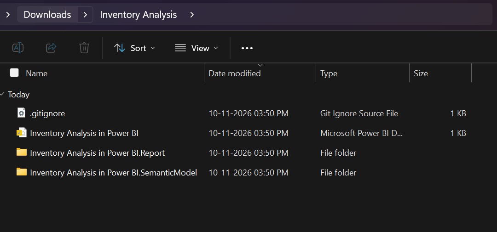
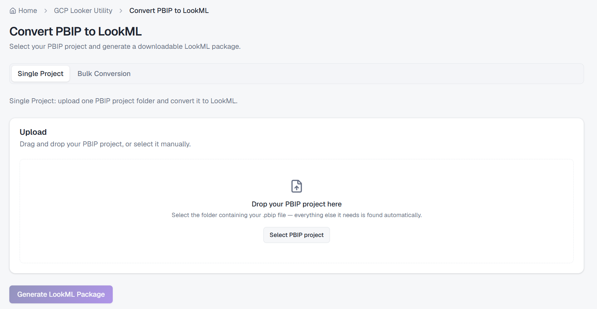
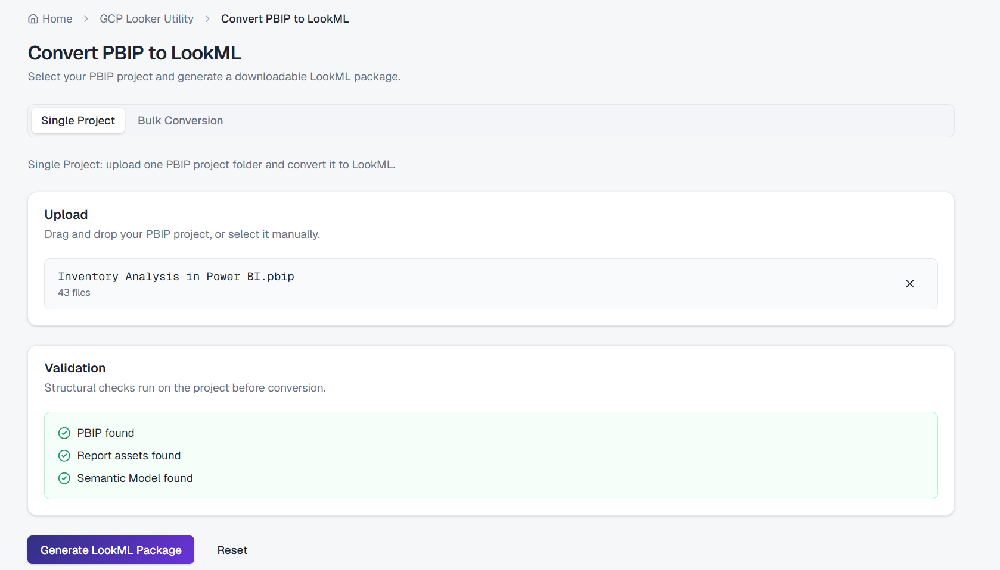
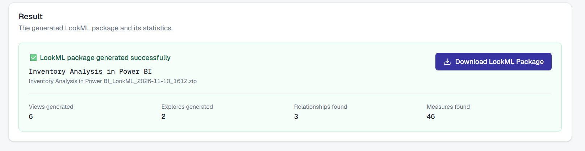
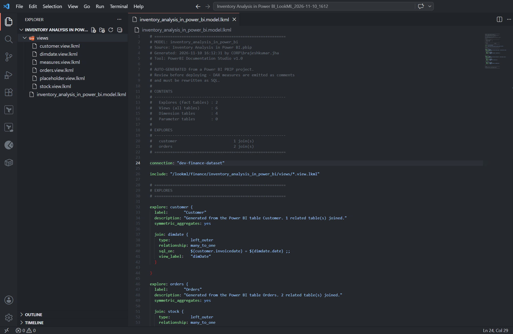

<div align="center">

# DataWorkbench

**Everyday tools for data engineers. Convert, analyze and explore data in your browser.**

[Live app](https://data-work-bench.vercel.app) | [API health](https://dataworkbench-api-v2.vercel.app/api/v1/health)

</div>

---

## Why DataWorkbench

Migrating BI assets means juggling scripts, CLIs and one-off converters. DataWorkbench brings them into one fast, mobile-friendly workspace with a searchable tool catalog.

## Flagship: Power BI to Looker

Convert **Power BI PBIP projects into LookML** for Looker, end to end:

- **Convert**: single project or bulk upload, with live progress
- **Preview**: inspect the generated LookML in a searchable code viewer
- **Explore**: browse the parsed model (tables, columns, measures, relationships)
- **Compare**: check a source model against the generated output

## How It Works

**1. Start from a Power BI PBIP project**



**2. Drop it into the converter**



**3. Review the project and generate**



**4. Get a LookML package with stats (views, explores, relationships, measures)**



**5. Open the generated LookML, ready for Looker**


## Platform

- Tool registry served by the API; add a tool by dropping in one module, with no other edits
- Typed end to end: the OpenAPI contract generates the frontend TypeScript types
- Responsive UI (Tailwind CSS v4) with dark mode and a mobile drawer navigation
- Global search, favorites and recently used tools

## Architecture

| Layer | Stack |
| --- | --- |
| Frontend | Next.js 16, React 19, Tailwind CSS v4, Zustand |
| Backend | FastAPI, Pydantic settings (`DWB_` prefix) |
| Hosting | Vercel (two projects: frontend and backend) |

```
backend/    FastAPI app, tests, OpenAPI export script
frontend/   Next.js app, generated API types
```

## Quick Start

Requires Python 3.11+ and Node.js 20.9+.

```powershell
# Backend (port 8010)
cd backend
python -m venv .venv
.venv\Scripts\python.exe -m pip install -r requirements-dev.txt
.venv\Scripts\python.exe -m uvicorn app.main:app --reload --port 8010

# Frontend (port 3000), in a second terminal
cd frontend
npm install
npm run dev
```

Frontend `frontend/.env.local` (required):

```
NEXT_PUBLIC_API_BASE_URL=http://127.0.0.1:8010/api/v1
```

Backend settings are optional (see `backend/.env.example`): `DWB_ENVIRONMENT`, `DWB_DEBUG`, `DWB_CORS_ORIGINS`.

## Deploy on Vercel

Two projects from this repo:

| Project | Root directory | Env vars |
| --- | --- | --- |
| Backend | `backend` (entry `index.py`) | `DWB_ENVIRONMENT=production`, `DWB_DEBUG=false`, `DWB_CORS_ORIGINS=["https://<frontend>.vercel.app"]` |
| Frontend | `frontend` | `NEXT_PUBLIC_API_BASE_URL=https://<backend>.vercel.app/api/v1` |

Order: deploy backend, set the frontend env var, deploy frontend, then update backend CORS with the final frontend URL and redeploy.

Serverless limits: request bodies are capped at about 4.5 MB and bulk jobs run in-process, so very large uploads are not reliable on Vercel.

## Development

```powershell
cd backend;  .venv\Scripts\python.exe -m pytest
cd backend;  .venv\Scripts\python.exe -m ruff check .
cd frontend; npm test; npm run typecheck; npm run lint; npm run build
```

After backend API changes, regenerate the contract:

```powershell
cd backend;  .venv\Scripts\python.exe -m scripts.export_openapi
cd ../frontend; npm run generate:api-types
```

`export_openapi --check` and `npm run check:api-types` fail on drift.

## Roadmap

- Persistent job storage for large bulk conversions
- Broader BI-to-Looker coverage and validation rules
- Shareable conversion reports


